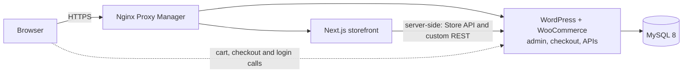

# Öfflinger shop

A headless online shop: a fast Next.js storefront on top of WordPress and
WooCommerce, which stay in the background for products, orders and the admin.
Built for a small German shop selling colloidal water products.

**Live demo:** https://oefflinger.dendigital.de. Buying is switched off, so no real
orders can be placed. The shop is in German.

## Background

WordPress with WooCommerce runs purely as the backend for products, orders and the
admin; customers only ever see the Next.js storefront. The shop was developed to the
point of launch, but the owner never gave the go-ahead, so it never opened (see
[Status](#status)).

## What it does

- **Product pages** with attributes, breadcrumbs, structured data (JSON-LD) and
  related products.
- **Sets and volume discounts.** A custom WordPress plugin builds product sets, and a
  shop-wide volume discount shows a live progress bar in cart and checkout. When a
  coupon is also used, whichever deal is better wins.
- **Cart and a native checkout** on the WooCommerce Store API, for guests or customer
  accounts, with coupons and a shipping estimate.
- **Customer accounts:** registration, login, order history and saved addresses.
  Registration, contact, newsletter and reviews are protected by Cloudflare Turnstile
  bot checks.
- **Content:** contact form, newsletter sign-up, product reviews, FAQ, shipping
  information and the German legal pages.
- **SEO:** server-rendered pages, sitemap, robots rules, canonical URLs, Open Graph
  and a switch that keeps search engines out until launch.
- **WordPress as a locked-down backend.** A small plugin redirects every WordPress
  page except checkout and order confirmation to the storefront. Custom REST
  endpoints cover login, stock, attributes, delivery estimates, reviews, contact
  and newsletter. Mail goes out over SMTP with branded templates.

## Architecture



- **Storefront:** Next.js 15 (App Router), React 19, TypeScript, Tailwind CSS 4.
  Pages render on the server over Docker's internal network; the cart, checkout and
  login talk to WooCommerce from the browser, with CORS limited to the storefront.
- **Backend:** WordPress with WooCommerce, the custom plugins in `wordpress/`, and
  MySQL 8. On first start WP-CLI installs WordPress and WooCommerce by itself.
- **Deployment:** Docker Compose (`docker/docker-compose.prod.yml`) behind Nginx
  Proxy Manager. A git push to the server runs `deploy/post-receive`, which rebuilds
  and restarts the containers.

```
frontend/           Next.js storefront
wordpress/api/      custom REST endpoints and WordPress hardening (must-use plugins)
wordpress/plugins/  the sets and volume-discount plugin
wordpress/theme/    the minimal theme for WooCommerce's checkout pages
docker/             compose files for local and production
deploy/             deploy hook
```

## Run it locally

You need Docker with Compose. In the cloned folder:

```bash
cp .env.example .env
docker compose -f docker/docker-compose.yml up --build
```

The storefront is then at http://localhost:4000 and the WordPress admin at
http://localhost:4001/wp-admin (user `admin`, password `WP_ADMIN_PASSWORD` from
`.env`). The shop starts empty: add a few products in the WordPress admin.

## Status

The shop is feature-complete up to launch, but it never opened because the owner
never gave the go-ahead. Buying is switched off in the demo.

## How it was built

Built by Damian Miela; much of the code was written with Claude, Anthropic's AI coding
assistant, under my direction.

## License

All rights reserved. The code is public so you can read it; please ask before reusing
any of it.
